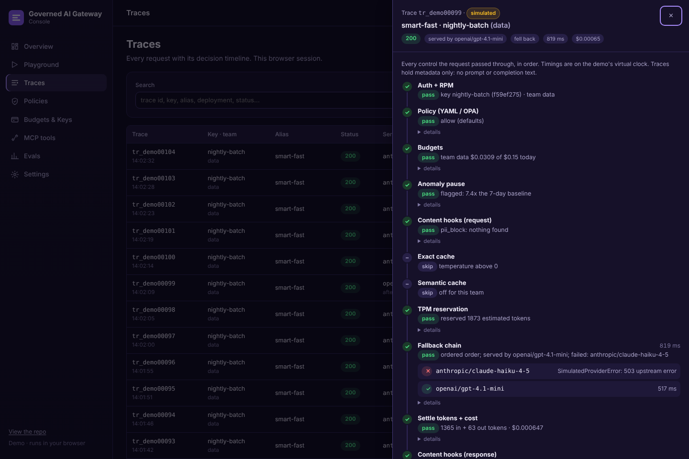

# Console

The console is the gateway's operator interface: one static application that shows every spend, policy, routing and tool decision the gateway makes, and lets an operator change the controls behind them. This document describes the sample business it is set in, its two run modes, its screens and the endpoints each screen uses. For the gateway itself, see the [README](../README.md) and [architecture](architecture.md).

**[Open the hosted console](https://coreymathie.github.io/governed-ai-gateway/demo/)**

## Sample business

The console is set in a sample business so the gateway can be judged at the scale it would run at: **Cypress Harbor Credit Union**, a *fictional* South Florida credit union (92,400 members, $1.4B in assets, 11 branches) whose seven teams (member services, digital banking, risk analytics, lending, compliance, IT and engineering, marketing) run eleven AI applications through the gateway with monthly budgets, about 12,000 requests a day. It opens on **Spend**, the view a FinOps or AI-gateway product leads with, with the **Requests** log next to it.

- **One definition**: [demo/cypress_harbor.py](../demo/cypress_harbor.py) lists each application's team, route alias, token sizes, temperature, hours and volume; [config/routes.yaml](../config/routes.yaml) is the credit union's route config (aliases, budgets, a daily cap per application key, content hooks, breaker settings) and [config/policies.yaml](../config/policies.yaml) its policy. The usage file, the request log and the in-browser engine's keys and runaway scenario are derived from them; the route-eval cases are tagged with its apps and sized to their prompts.
- **Usage**: 90 days of traffic and spend from [scripts/generate_sample_company.py](../scripts/generate_sample_company.py). Each app's requests are served by its route's deployments, so spend by team and by model follows from the request mix; the three provider incidents, the September 24 runaway (a sample scenario: a coding agent looping on `heavy-reasoning`, replayed call by call through `anomaly.classify()` and paused at 10.2x its baseline 69 seconds after it starts; generated, not a measured detection time, and the live gateway's 30-second verdict cache can pause it up to 30 seconds later) and the activity feed are computed from the daily data and the breaker settings.
- **Request log**: 500 requests from October 1 to 7 from [scripts/sample_requests.py](../scripts/sample_requests.py), each with the fields and decision stages the gateway records for a real one ([router/traces.py](../router/traces.py)). Costs are tokens times list prices; the policy stage is `router/policy.py`'s decision under `config/policies.yaml`; budgets in each trace are the team's month-to-date spend and the key's spend that day against its cap; and the October 6 Anthropic overload (the first failures, then requests skipping the open breaker), the October 2 contractor-policy refusal and the October 5 on-prem timeout are the requests the activity feed describes.
- **Checks**: [tests/test_sample_consistency.py](../tests/test_sample_consistency.py) and [tests/test_sample_requests.py](../tests/test_sample_requests.py) fail if Spend by model drifts from the request mix, if an app's route differs between config, engine, log and Spend, if an alias in the log is not in the config, if an activity-feed number or incident threshold does not match the data and config, if any day exceeds a cap, or if demo-facing files mention the generic shop or SaaS examples the console used before.

### How the sample numbers were set

The Spend screen ends with a **How these sample numbers were set** panel that renders this table from `BENCHMARKS` in [demo/cypress_harbor.py](../demo/cypress_harbor.py) (written into `demo/data/sample_company.json` by the generator). A figure is marked as cited only when its source page was fetched and read and the figure is quoted from it; where the sample value is a derived ratio, a **Check** says how it compares with the published figure. `tests/test_sample_consistency.py` checks that every cited row has a URL and a quote, that the cited prices are the prices the sample uses, that the checked ratios follow from the company definition and the usage file, and that this table lists every row. The numbers stay generated sample data calibrated to these inputs, not measurements.

| Figure | Value used | Source or assumption |
|---|---|---|
| Claude Haiku 4.5 list price | $1.00 in, $5.00 out per 1M tokens | [Pricing - Claude Platform Docs](https://docs.claude.com/en/docs/about-claude/pricing), Anthropic, 2026: "Claude Haiku 4.5 $1 / MTok $5 / MTok" (Model pricing table, columns Base tokens: Input, Output; read 2026-11-03) |
| Claude Sonnet 4.5 list price | $3.00 in, $15.00 out per 1M tokens | [Pricing - Claude Platform Docs](https://docs.claude.com/en/docs/about-claude/pricing), Anthropic, 2026: "Claude Sonnet 4.5 $3 / MTok $15 / MTok" (Model pricing table, columns Base tokens: Input, Output; read 2026-11-03) |
| GPT-4.1 list price | $2.00 in, $8.00 out per 1M tokens | [Pricing](https://developers.openai.com/api/docs/pricing.md), OpenAI, 2026: "gpt-4.1 $2.00 $8.00 $0.50" (Standard pricing table, prices per 1M tokens, columns Model, Input, Output, Cached input; read 2026-11-05) |
| GPT-4.1 mini list price | $0.40 in, $1.60 out per 1M tokens | [Pricing](https://developers.openai.com/api/docs/pricing.md), OpenAI, 2026: "gpt-4.1-mini $0.40 $1.60 $0.10" (Standard pricing table, prices per 1M tokens, columns Model, Input, Output, Cached input; read 2026-11-05) |
| GPT-4.1 nano list price | $0.10 in, $0.40 out per 1M tokens | [GPT-4.1 nano](https://developers.openai.com/api/docs/models/gpt-4.1-nano), OpenAI, 2026: "Input $0.10 Cached input $0.025 Output $0.40" (Pricing, Text tokens, per 1M tokens. The page now marks the model "Shut down", and the current pricing page no longer lists it; read 2026-11-05) |
| Gemini 2.5 Flash list price | $0.30 in, $2.50 out per 1M tokens | [Gemini Developer API pricing](https://aistudio.google.com/docs/pricing), Google, 2026: "Input price Free of charge $0.30 (text / image / video) $1.00 (audio) Output price (including thinking tokens) Free of charge $2.50" (Gemini 2.5 Flash, Standard table, columns Feature, Free Tier, Paid Tier per 1M tokens in USD. The page marks gemini-2.5-flash deprecated, with requests routed to Gemini 3.5 Flash-Lite from December 1, 2026; read 2026-11-05) |
| On-prem Llama 3.1 8B chargeback | $0.05 in, $0.05 out per 1M tokens | assumption (no public benchmark): an internal GPU chargeback rate, which no provider publishes. |
| Credit union size: members and assets | 92,400 members, $1.4B in assets | [Quarterly Credit Union Data Summary 2026 Q2](https://ncua.gov/files/publications/analysis/quarterly-data-summary-2026-Q2.pdf), NCUA, 2026: "As of June 30, 2026, there were 4,214 federally insured credit unions with 146.1 million members." (Tables, 2026 Q2: total assets $2,498.9 billion; by type, complex credit unions (assets greater than $500 million) 124.2 million members and $2,186.3 billion in assets, small credit unions (assets less than $100 million) 6.3 million and $73.8 billion, federally insured state-chartered credit unions 65.7 million and $1,191.9 billion; 90% of credit unions are smaller than $1,135.7 million; read 2026-11-05) Check: $1.4B over 92,400 members is $15,152 in assets per member. NCUA's tables give $17,104 per member across all federally insured credit unions, $17,603 for complex credit unions, and $11,714 (small credit unions) to $18,142 (state-chartered) across the types they report, so the sample sits inside that range. At $1.4B the credit union is a complex credit union, larger than 90% of credit unions. |
| Staff and branches | 340 employees, 11 branches | assumption (no public benchmark cited): NCUA's quarterly data summary reports members and assets but not employees or branches, and no other published figure for them was read. |
| AI requests through the gateway | about 12,000 a day (373,000 in 30 days) across 11 apps | assumption (no public benchmark cited): set from each app's assumed working-day volume; no published figure for AI requests per institution is quoted. |
| AI spend and team budgets | $943 in 30 days against $1,099 in team budgets; $2.53 per 1,000 requests | derived: requests times token sizes times the list prices above; the team budgets are the credit union's config/routes.yaml, set as assumptions. The next row checks the spend per employee against a published figure. |
| AI spend per employee | $2.77 per employee per month ($943 in 30 days over 340 employees) | [August 2026 Ramp AI Index: Cracks in the AI thesis](https://ramp.com/data/ai-index-august-2026), Ramp, 2026: "In July, the top 1% of businesses spent a median $7,400 per employee on AI. The top 10% spent $650. The median firm spent $11.95 per employee." (Chart "AI spend per employee per month"; AI spend includes LLM subscriptions, coding agents, API tokens, and GPU cloud spend; read 2026-11-05) Check: The gateway carries API tokens only: $2.77 per employee per month, below the median firm's $11.95, which also counts LLM subscriptions, coding agents and GPU cloud that do not pass through a gateway. The sample sits in the lower half of Ramp's distribution; 340 employees is an assumption (see Staff and branches). |
| Exact-match cache hit rate | 17% to 21% for the member-facing apps, 0% to 9% for back-office apps | assumption (no public benchmark cited): set from how often members are expected to ask the same question in the same words; no published repeat-query rate is quoted. |
| Provider incidents and success rate | three incidents in 90 days (12 to 47 minutes); 4 failed requests in 30 days | assumption (no public benchmark cited): scenarios written to exercise the fallback chain and breakers, not taken from provider status-page history. |

Every provider price the sample uses matches the provider's published list price, the credit union's assets per member sit inside the range NCUA's tables give by type of credit union, and its AI spend per employee is below Ramp's median firm, so no generator parameter changed and the Spend figures are unchanged. Two of the models have since been retired: OpenAI's model page marks GPT-4.1 nano "Shut down" without a date on the pages read, and Google routes Gemini 2.5 Flash requests to Gemini 3.5 Flash-Lite from December 1, 2026. The sample (July 10 to October 7, 2026) keeps both at the prices quoted. Staff and branch counts, request volumes, cache hit rates, team budgets, the on-prem chargeback rate and the incidents remain stated assumptions.

Both files are seeded, checked in CI and labelled **Sample** everywhere, apart from **measured** results and the **simulated** requests sent in the tab. Spend and Requests render from those files immediately; the screens that run the gateway's code wait for Pyodide and say so.

## Run modes

One static app in [demo/](../demo/) has two adapters behind the same interface ([demo/adapters.js](../demo/adapters.js)). The header badge states which one is running, and anything simulated is labelled as such.

| Mode | Adapter | What runs | Where |
|---|---|---|---|
| **Demo** | `DemoAdapter` | The gateway's own `router/*.py` modules (policy, budgets, breakers, fallback chain, anomaly thresholds, PII hooks, caches, MCP tool policy, showback, config validation) in the browser via Pyodide 0.26.4, with [demo/engine.py](../demo/engine.py) supplying **simulated** providers. No API keys, no provider calls. | GitHub Pages |
| **Live** | `LiveAdapter` | The gateway's HTTP API. | `/console/` on a running gateway |

The mode is chosen by `?mode=demo|live`, otherwise auto-detected through the public `GET /console/api-mode`.

In demo mode the console loads [demo/cypress_harbor.py](../demo/cypress_harbor.py) and these modules unchanged: `breaker`, `fallback`, `latency`, `tokens`, `budgets`, `anomaly`, `costs`, `showback`, `pii`, `policy`, `semcache`, `mcp_policy`, `configcheck`, `traces`, plus `models` on demand with Pyodide's pydantic to validate `routes.yaml` with the gateway's `RouterConfig`. `tests/test_demo_engine.py` checks the list and fails if one of them gains a third-party import at module level. The **Settings** screen lists the files running in the browser with their hashes.

Demo mode simulates providers, time (a virtual clock) and the hours before "now" on its overview chart. The tab sends dozens of requests where the credit union sends thousands an hour, so the engine's caps and 7-day anomaly baselines are the credit union's divided by 25 (`ENGINE_SCALE`), as Budgets & Keys states; simulated traffic carries each app's prompt size, temperature and cache hit rate. Live mode with `ROUTER_MOCK_PROVIDERS=true` simulates providers only.

### Run it live

`docker compose up`, then open http://localhost:4000/console/. Compose builds the gateway with `ROUTER_MOCK_PROVIDERS=true` ([router/mock_provider.py](../router/mock_provider.py)): every provider call is answered in-process by a **simulated** OpenAI-compatible provider, and MCP tool calls go to simulated MCP servers ([config/mcp.mock.yaml](../config/mcp.mock.yaml)), so it needs no API keys and calls nothing. Costs in that mode are simulated token counts at the configured prices. The admin key is `ROUTER_ADMIN_KEY` from `.env`, or one generated on first start: `docker compose exec gateway cat /data/admin-key.txt` (never logged). Set `ROUTER_MOCK_PROVIDERS=false` and provider keys to route real traffic.

Without Docker, `ROUTER_MOCK_PROVIDERS=true uvicorn router.main:app --port 4000` does the same.

### Run the in-browser console locally

Run `python -m http.server 8000` from the repository root, then open `http://localhost:8000/demo/` (Pyodide loads from jsDelivr). The hosted link needs GitHub Pages enabled for the repository (branch `main`, folder `/`).

## Audience views and navigation

**Business and technical views.** The header switch (or `?view=technical`) chooses the audience. The business view shows apps, teams, models by name, outcomes ("Answered after fallback", "Refused by policy") and a plain-language account of each request; the technical view adds keys and fingerprints, route aliases, token counts, stage names and timings, stage details and the raw record. Light and dark themes follow the system and can be switched in the header.

**Navigation.** Screens are grouped by job (Monitor, Operate, Govern, Configure) with sub-pages, breadcrumbs, a command palette (<kbd>Ctrl</kbd>/<kbd>⌘</kbd> <kbd>K</kbd> or <kbd>/</kbd>) over screens and actions, `g` + letter shortcuts (<kbd>?</kbd> lists them), a collapsible sidebar, and a guided tour offered on the first visit.

## Screens

| Screen | What it does | Live endpoints |
|---|---|---|
| **Spend** | For the sample credit union over 7, 30 or 90 days: AI spend against team budgets, requests served, cost per 1,000 requests, cache savings, success rate with fallback rescues, spend stopped by an anomaly pause, policy decisions enforced and regulated requests kept on-prem, each against the previous period; October so far by team with the month-end forecast against budget; latest requests; daily spend by team; budgets by team; spend by model; provider incidents; governance checks; recent activity linked to the requests it describes | `demo/data/sample_company.json`, `demo/data/sample_requests.json` |
| **Spend › This session** | Spend by team and model, requests, fallback rate, cache savings, anomaly flags, open circuits; spend per hour vs. each hour's 7-day average; guided "what to try" cards | `GET /admin/overview` |
| **Requests** | The sample company's request log: search, filter by team, outcome, model and day, page through, export CSV. Each request opens a page with what happened in plain words, cost, response time and gateway overhead, the model that answered and any failed attempt, the team's budget, every control it passed in order, recent requests from the same app, and (technical view) key fingerprint, stage details and the raw record | `demo/data/sample_requests.json` |
| **Requests › This session** | Requests sent in this tab (demo) or handled by the gateway (live), filterable by team, outcome and free text; a drawer with the full decision timeline: auth → policy/OPA → budgets → anomaly → PII hooks → exact and semantic cache → TPM → each fallback attempt with its breaker state → cost settle → response hooks → content log. Deep-linkable (`#/traces/<id>`), browser back closes it | `GET /admin/traces`, `GET /admin/traces/{id}` |
| **Playground** | Send a chat request as any app key and alias and see who answered, what it cost and each stage it passed; compare two routes side by side over N runs; take a simulated provider down (outage, 429s, error rate, latency) and watch breakers open, fall back and recover; semantic-cache playground (demo) | `/v1/chat/completions`, `/admin/mock/providers`, `/admin/circuits`, `/admin/circuits/reset` |
| **Policies** | Edit `config/policies.yaml`, `routes.yaml` and the MCP file; validate with the gateway's own loaders (errors inline with line numbers); preview every team × route decision against the active policy before applying; apply and re-run a request | `GET/PUT /admin/config/{name}`, `POST /admin/config/{name}/validate`, `POST /admin/policies/dry-run` |
| **Budgets & Keys** | Org and team caps and TPM (editable), create/revoke app keys (secret shown once), pause/unpause keys and override an anomaly pause for the hour, showback table and CSV export | `/admin/budgets/{scope}/{name}`, `/admin/keys/{id}/pause`, `/unpause`, `/admin/showback` |
| **MCP tools** | Team × tool allow-list, try allowed, denied and velocity-limited tool calls, audited (redacted) arguments | `GET /admin/mcp`, `POST /mcp/{server}`, `GET /admin/audit?category=mcp` |
| **Evals** | Route cost-vs-quality scorecard and CI gate example (simulated profiles), semantic-cache calibration (threshold picked on the development pairs, measured there and on the separate held-out set, before and after the guard fix; re-runnable in the browser), test inventory | `demo/data/*.json` from [scripts/build_console_data.py](../scripts/build_console_data.py) |
| **Settings** | Admin key (kept in the tab's session storage unless the operator chooses to remember it), roles, gateway controls (breakers, auto-pause, caches, PII hook mode per team), the files running in the browser with their hashes, guided tour | `GET /admin/policies`, `/admin/semantic-cache` |

The month-end forecast on **Spend** projects each team's month-to-date spend at its current daily rate over the sample data; the gateway API itself has no forecasting endpoint (see [controls mapping](controls.md#finops-for-ai)).

## Verification

`python scripts/demo_smoke.py --both` drives every screen in headless Chromium in both modes; `--pyodide-dir` serves a local copy of Pyodide instead of jsDelivr, and `--screenshots` writes desktop and 390 px screenshots. It also opens Spend with the browser locale set to fr-FR and checks that money still reads `$…` and that figures are marked `translate="no"`. Results are in [evaluation](evaluation.md#console-smoke-test). CI runs the live smoke and the demo smoke; the demo run is allowed to fail on CDN problems.

The older server-rendered dashboard is still at `/dashboard` and links to the console.
